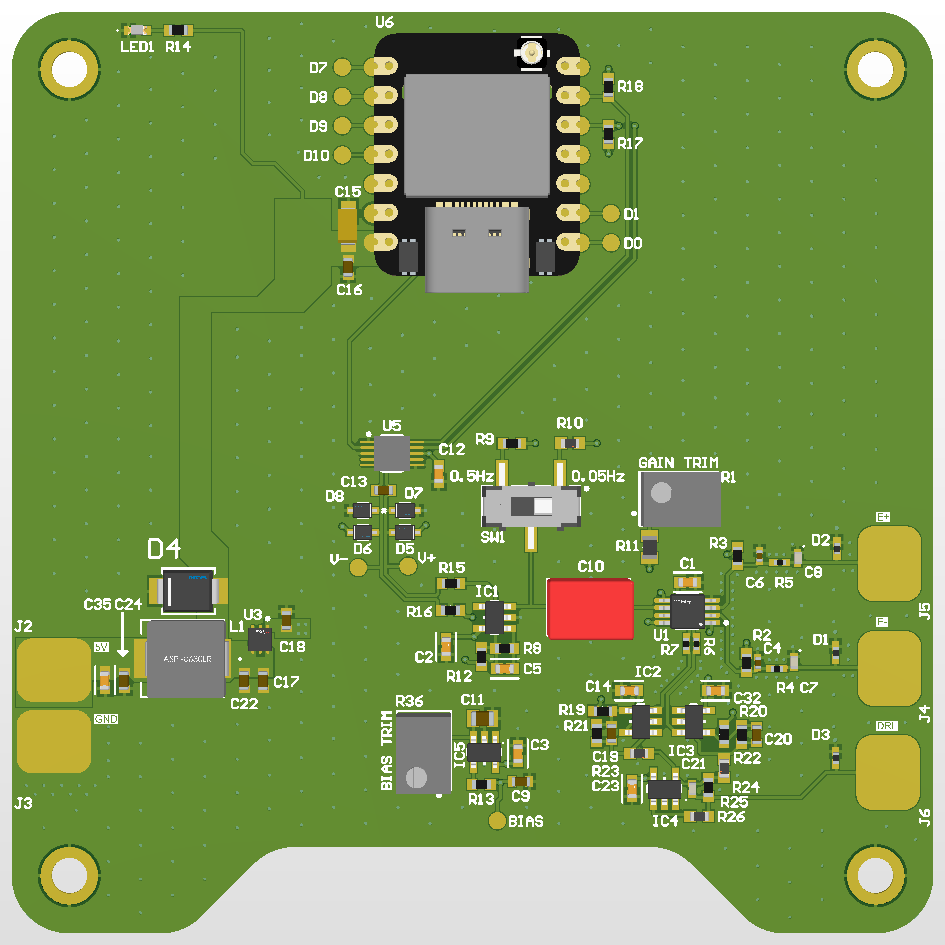
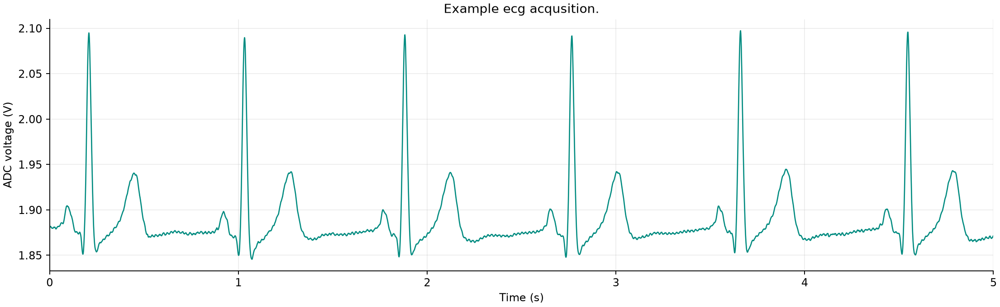
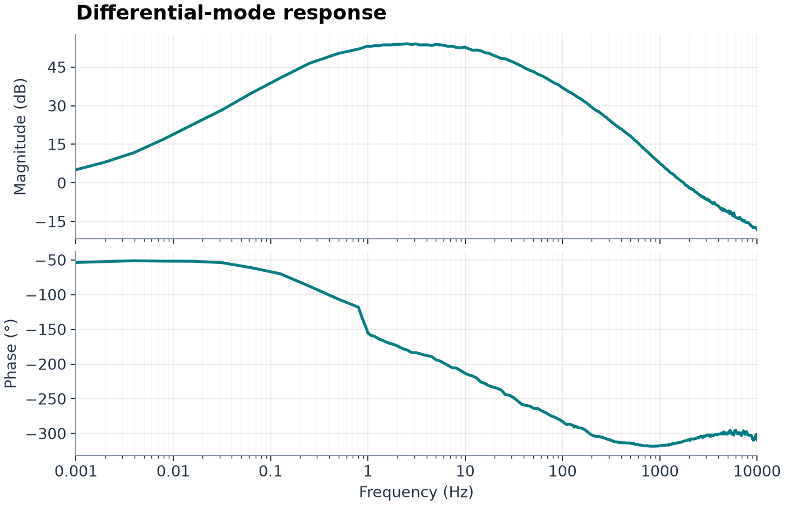
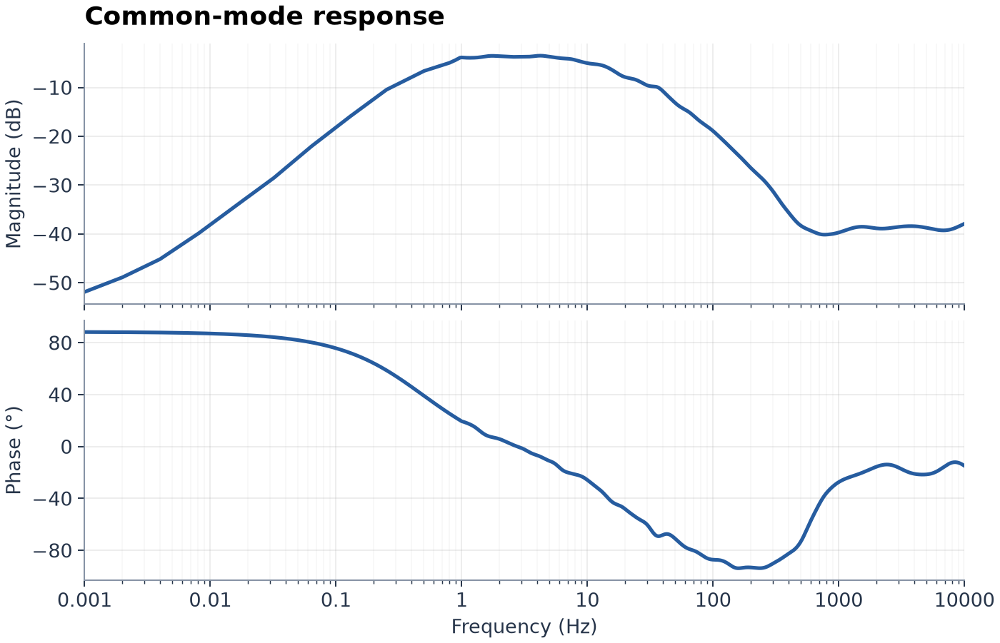
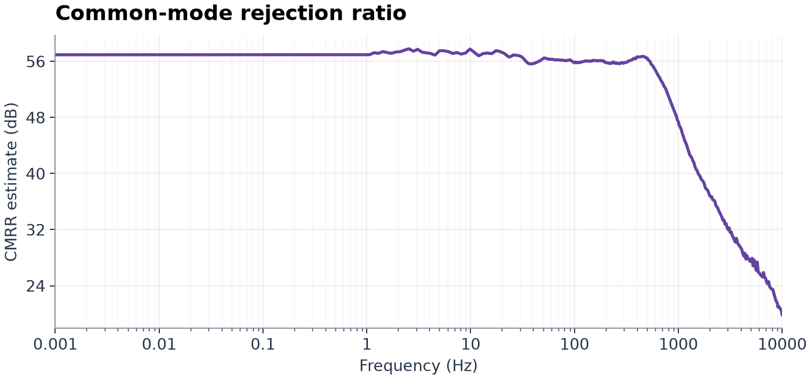

# ESP32 ECG

A single-lead ECG built around a custom analog frontend, an ADS1115 ADC and a Seeed XIAO ESP32-S3. The project combines PCB design files, device firmware and a desktop application for live monitoring, recording, calibration and firmware updates. A web monitor is also available over Wi-Fi.

[Hardware schematic](EKG.pdf) · [Releases](https://github.com/tormodhagen/esp32-ecg/releases) · [License](LICENSE)



## Example recording

<a href="docs/images/example-ecg.png"></a>

A five-second excerpt recorded with the ECG hardware. The vertical axis shows the exported ADC voltage, including its DC offset and analog amplification; it is not the calibrated voltage at the electrodes. No additional digital filtering was applied to this plot.

## PCB frequency response

Estimated PCB frequency response from **1 mHz to 10 kHz**.

### Differential mode

<a href="docs/images/differential-mode.png"></a>

The differential response peaks at **54.1 dB** and reaches its upper −3 dB point near **15 Hz**.

### Common mode

<a href="docs/images/common-mode-response.png"></a>

### Common-mode rejection ratio (CMRR)

<a href="docs/images/cmrr-response.png"></a>

The estimated common-mode rejection is **56.4 dB at 50 Hz**.

## Desktop application

The ECG Monitor provides live ECG display, recording playback, calibration and an integrated firmware updater.

### Run from source

From the repository root, with Python installed:

```powershell
python -m pip install -r desktop/requirements-desktop.txt
python desktop/main.py
```

### Build the Windows application

```powershell
Unblock-File .\scripts\build_apps.ps1
Set-ExecutionPolicy -Scope Process -ExecutionPolicy RemoteSigned -Force
.\scripts\build_apps.ps1
```

The output is **`dist/ECG-Monitor.exe`**, a single executable containing the monitor, updater, Python runtime and bundled Espressif OTA script. The build script selects a compatible Python environment or creates one and installs the required dependencies. Use `-Python` to select an interpreter explicitly. First launch may take a moment while the bundled runtime is extracted.

## Firmware

The PlatformIO environment is named `esp32dev`, but the configured target is **Seeed XIAO ESP32-S3**.

### Initial setup and USB upload

1. Install PlatformIO.
2. Copy `firmware/src/ota_config.example.h` to `firmware/src/ota_config.h`. Set a private 16-character alphanumeric token and, optionally, initial Wi-Fi credentials. Keep this file private.
3. Build and upload over USB:

```powershell
python firmware/embed_web.py
pio run -d firmware -e esp32dev --target upload
```

The application binary is written to `firmware/.pio/build/esp32dev/firmware.bin`. Regenerate the embedded web assets with `python firmware/embed_web.py` whenever the web interface changes. Initial installation or partition-table changes require USB upload.

### Build and update over the air

```powershell
# Compile only
.\scripts\build_firmware.ps1 -BuildOnly

# Build and update using BLE activation, followed by Wi-Fi transfer
.\scripts\build_firmware_ota.ps1

# Build and update using an IP address or hostname
.\scripts\build_firmware_ota.ps1 -DeviceAddress ecg.local
```

These scripts regenerate the web assets, compile the firmware and upload only after a successful build. Optional parameters include `-Pio`, `-Python`, `-Environment` and `-BleAddress`. Close the live ECG connection before using the standalone updater.

### Update from the desktop application

Open **Device → Firmware update…** and select an application `.bin`, or select the firmware project to build it first. Enter an IP address or hostname for HTTP activation followed by ArduinoOTA transfer; leave the address blank to use BLE activation followed by ArduinoOTA. Use the token configured in the running firmware.

Save or discard active recordings before updating, and keep the device powered throughout the transfer. Updating an existing binary from the Windows executable requires neither a separate Python installation nor PlatformIO; compiling firmware requires PlatformIO. Direct multipart HTTP upload is available through the standalone script with `-DirectHttp -DeviceAddress <address>`.

## Repository layout

| Path | Contents |
| --- | --- |
| `Altium Docs/` | PCB and schematic design sources |
| `EKG.pdf` | Hardware schematic PDF |
| `desktop/` | ECG monitor, signal processing, calibration and updater |
| `firmware/` | PlatformIO firmware and web interface |
| `scripts/` | Build, launch and configuration tools |
| `tests/` | Automated software checks and hardware diagnostics |
| `docs/images/` | ECG recording and frontend characterization figures |
| `docs/legacy/` | Earlier documentation; current setup instructions are above |
| `dist/` | Generated Windows executable after building |

## Development

The test suite covers signal processing, binary decoding, calibration metadata, transfers and release handling. Hardware-dependent serial/BLE diagnostics require a connected device. A software check alone does not verify physical acquisition or Wi-Fi/BLE/OTA operation on the hardware.

## License

This project is licensed under the [GNU General Public License v3.0](LICENSE).
